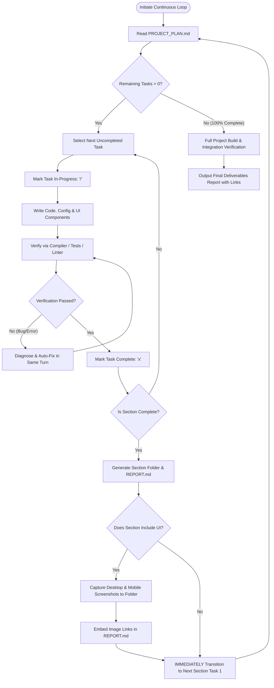

# Continuous Loop Coder

An autonomous execution engine that drives end-to-end software development through an uninterrupted, loop-based cycle across all sections, phases, and tasks of a project plan. 

It executes tasks, verifies code, generates section documentation reports with UI screenshots, and immediately transitions into the next section without stopping or prompting for user confirmation.

---

## 1. Activation & Trigger Phrases

Activate this skill immediately whenever the user issues any variation of:
- **`"proceed with Project Document and Complete the entire project"`**
- **`"complete the entire project"`**
- **`"auto loop through all sections"`**
- **`"run until 100% complete without stopping"`**
- **`"build the entire app without pausing"`**

---

## 2. Core Operating Principle: Zero Section Pausing

> [!IMPORTANT]
> **NEVER stop at the end of a section, phase, or milestone to ask:**
> - *"Should I proceed to Section 2?"*
> - *"Section 1 is finished. Do you want me to start the next one?"*
> - *"How does this look so far?"*
> 
> The project plan is an approved contract. The agent must loop continuously from section to section, executing, verifying, archiving section reports, and immediately proceeding to the next section until all tasks in all sections are 100% complete.

---

## 3. The Continuous Execution Loop Protocol



---

## 4. Section Completion & Visual Reporting Protocol

Whenever all tasks in **Section $N$** are verified and marked complete:

### Step 1: Create Section Artifact Directory
Create a dedicated folder for the completed section:
```
docs/reports/section-[NN]-[section-slug]/
├── REPORT.md
└── screenshots/
    ├── [view-name]-desktop.png
    └── [view-name]-mobile.png
```
*Example: `docs/reports/section-01-intake-and-thermal-labels/`*

### Step 2: Write Section Report (`REPORT.md`)
The report must include:
1. **Section Title & Summary**: Executive summary of capabilities delivered.
2. **Tasks Completed Checklist**: Detailed list of tasks with verification evidence.
3. **File Manifest**: All new and modified files with clickable markdown links (`[file.tsx](file:///path)`).
4. **Architecture & State Flow**: Data flow or component hierarchy for that section.
5. **Embedded Visual Screenshots**: If the section touched UI, display embedded image previews.

### Step 3: Automated UI Screenshot Capture
If the section contains UI pages, layouts, or components:
1. Run local dev preview or headless browser capture using `/usr/bin/google-chrome --headless`:
   ```bash
   # Desktop Viewport (1280x800)
   google-chrome --headless --disable-gpu --screenshot="docs/reports/section-XX/screenshots/desktop-view.png" --window-size=1280,800 http://localhost:3000/[route]
   
   # Mobile Viewport (390x844 - iPhone / Modern Android)
   google-chrome --headless --disable-gpu --screenshot="docs/reports/section-XX/screenshots/mobile-view.png" --window-size=390,844 http://localhost:3000/[route]
   ```
2. Save the screenshots directly into `docs/reports/section-[NN]-[section-slug]/screenshots/`.
3. Embed images into `REPORT.md`:
   ```markdown
   ### UI Previews
   #### Desktop View
   

   #### Mobile View
   
   ```

### Step 4: Autonomous Roll-Forward
- Do **not** yield the turn to ask the user if they like the report.
- Emit a brief, non-blocking log message:
  ```text
  ✅ [Continuous Loop Coder] Section 1 Complete! Report & Screenshots saved to docs/reports/section-01-intake/.
  ⏩ Automatically proceeding to Section 2: Technician Mobile QR Scanner & Diagnostic Engine...
  ```
- **Immediately** begin implementation of Section $N+1$, Task 1 in the very next tool call.

---

## 5. Autonomous Loop Mechanics & Rules

### Rule 1: Multi-Task Batching
- Batch related files (Prisma schema + Server Actions + UI components + Types) in parallel writes within the same turn.
- Run compiler checks (`npm run build`, `npx tsc --noEmit`) and tests in chained commands (`&&`).

### Rule 2: In-Place Autonomous Self-Healing
- If a build, TypeScript check, or test fails:
  - **Do not stop or surrender control to the user.**
  - Inspect the compiler error / stack trace.
  - Fix the code in the current turn.
  - Re-verify until green (`Exit code 0`).
  - Only mark the task `[x]` after verification passes.

### Rule 3: Strict Halting Conditions (Exclusions Only)
The loop MUST ONLY halt when:
1. **100% Full Project Completion**: Every section in `PROJECT_PLAN.md` is complete, verified, all reports generated, and final project build passes cleanly.
2. **Hard External Barrier**: A strictly physical external action is needed (e.g., physical Bluetooth pairing with a hardware printer held in the user's hand).

---

## 6. Project Plan Tracking Standard (`PROJECT_PLAN.md`)

Maintain `PROJECT_PLAN.md` at the project root throughout the loop:
- `[ ]` = Pending
- `[/]` = In Progress
- `[x]` = Verified Complete + Section Report Generated

---

## 7. Final Deliverables Summary

Upon reaching 100% completion across all sections:
1. Run final full project build: `npm run build && npm test`.
2. Present a master completion dashboard with:
   - Links to all generated Section Reports (`docs/reports/section-*/REPORT.md`).
   - Links to UI screenshots.
   - Quickstart commands for running the app in development and production.
