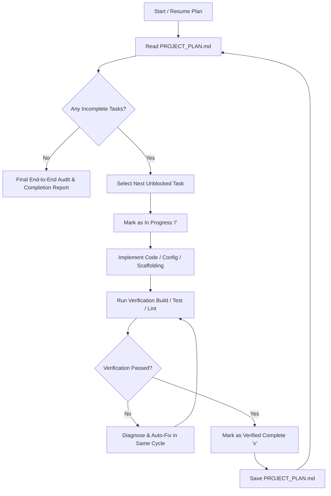

# Iterative Plan Executor

This skill defines the methodology, state tracking, and autonomous execution loop required to drive a multi-phase project plan to full completion across multiple iteration cycles.

---

## 1. When to Use This Skill

- Driving a multi-step project plan (e.g., building a complete POS app, refactoring architecture, or multi-phase feature development).
- Ensuring the agent iterates continuously through tasks rather than halting prematurely after a single subtask.
- Maintaining clear milestone tracking (`[ ]`, `[/]`, `[x]`) and verifiable checkpoints.

---

## 2. Project Plan Standard Structure (`PROJECT_PLAN.md`)

When initializing or executing a project plan, structure it using this standard schema:

```markdown
# Project Plan: [Project Name]

## Overall Progress: [X/Y Tasks Complete - Z%]

### Phase 1: Foundation & Architecture [Status]
- [x] Task 1.1: [Task Title] - *Verified by [Test / Build command]*
- [/] Task 1.2: [Task Title] - *In progress*
- [ ] Task 1.3: [Task Title]

### Phase 2: Core Domain & Business Logic [Status]
- [ ] Task 2.1: [Task Title]
- [ ] Task 2.2: [Task Title]

### Phase 3: Hardware / Native Integration [Status]
- [ ] Task 3.1: [Task Title]

### Phase 4: UI / UX & End-to-End Verification [Status]
- [ ] Task 4.1: [Task Title]
```

---

## 3. The 5-Step Autonomous Execution Loop



### Step 1: Inspect and Select
1. Read `PROJECT_PLAN.md`.
2. Locate the current active phase.
3. Select the next highest-priority task that has all prerequisites met.
4. Mark task as `[/]` in progress.

### Step 2: Implement (Batch Action)
1. Write or edit source code, configuration, or documentation.
2. Maintain clean separation of concerns and adhere to architecture patterns.
3. Batch related edits in the same turn for efficiency.

### Step 3: Rigorous Verification
1. Run target compilers or static analysis:
   - Flutter: `flutter analyze` / `dart analyze` / `flutter test`
   - Node / React Native: `npm test` / `tsc --noEmit`
   - Android / Kotlin: `./gradlew check`
2. Check for runtime regressions or missing imports.

### Step 4: Update State
1. Update `PROJECT_PLAN.md`: mark task as `[x]`.
2. Append verification evidence (e.g. `flutter analyze: 0 issues found`).
3. Update overall percentage calculation.

### Step 5: Autonomous Next-Cycle Trigger
- **Crucial Rule**: Do NOT pause or ask the user for confirmation if the next task is clearly scoped in the plan.
- Seamlessly transition into the next task in the plan.

---

## 4. Handling Blockers and Escalation

| Scenario | Autonomous Action | When to Escalate to User |
| :--- | :--- | :--- |
| **Compiler / Test Failure** | Diagnose error log, fix syntax/types, re-verify in same turn. | Never escalate standard code/test errors; auto-heal them. |
| **Missing Third-Party Secret** | Mock the dependency or use sandbox/test credentials. | Escalate only if real production API secret or OAuth login is strictly required. |
| **Physical Hardware Interaction** | Implement mock/simulator fallback (e.g., Virtual Bluetooth printer loopback). | Ask user only for physical confirmation when testing on a real device. |
| **Design / Scope Ambiguity** | Use sensible industry-standard defaults (e.g., standard ESC/POS 32-col layout). | Escalate if choosing between mutually incompatible product strategies. |

---

## 5. Termination Condition

The iterative execution loop concludes ONLY when:
1. Every task across all phases is marked `[x]`.
2. The entire project builds cleanly with zero errors.
3. All acceptance criteria have passed verification.
4. A final summary report is delivered to the user with clickable file links.
